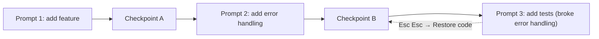

# 08 — Checkpoints & Rewind

## At a glance

| | |
| --- | --- |
| **Level** | Intermediate |
| **Time** | ~45 min |
| **Prereq** | None — this pairs well early, right after [02-memory](../02-memory/) |
| **Artifacts** | Template in this folder; your lab output goes in [`../artifacts/demos/`](../artifacts/demos/) |

## Why this matters

You're three prompts into a refactor. Prompt 1 was clean. Prompt 2 added error handling you liked. Prompt 3 — "now add tests" — also decided to "simplify" the error handling from prompt 2, and you didn't notice until CI failed. `git checkout` gets you back to your last commit, but you hadn't committed yet, and you don't want to lose the *conversation* either — you want Claude to remember what it tried and why it didn't work.

That's what **checkpoints** are for: a built-in time machine for both your files and the conversation, scoped per-prompt, that survives even if you close the terminal. Staff engineers use this instead of "just be careful" — checkpoints turn risky experiments into free experiments.

## Concept primer

Claude Code automatically saves a **checkpoint** before it processes anything that could modify files. You don't create checkpoints manually — every prompt creates one for free.

Open the rewind menu with `/rewind` or by pressing **`Esc` `Esc`** while the input line is empty (if you have text typed, `Esc Esc` just clears the draft — press `Up` to get it back).

| Restore option | Reverts files | Reverts conversation | Use it when |
| --- | --- | --- | --- |
| **Restore code and conversation** | Yes | Yes | The whole last N prompts were a dead end |
| **Restore conversation** | No | Yes | Code is fine, but you want to re-ask the question differently |
| **Restore code** | Yes | No | You want Claude to *remember* what it tried, just not keep the result |
| **Summarize from/up to here** | No | Compresses | You're burning context on a segment you don't need verbatim anymore |

> **Tip:** Checkpoints persist across sessions and (by default) for 30 days — closing the terminal doesn't lose your rewind history for that project.

## Hands-on walkthrough

1. **Create a throwaway file to experiment on.**
   - Action: ask Claude to create a small scratch file, e.g. `artifacts/demos/scratch-counter.py` with a simple function.
   - Expect: the file exists; note this created checkpoint A.

2. **Make an intentionally bad edit.**
   - Action: ask Claude to "refactor this to use a global variable instead of a parameter" (a change you plan to reject).
   - Expect: the edit happens; you disagree with the result on read-back.

3. **Rewind code only.**
   - Action: with an empty input line, press `Esc` `Esc` (or run `/rewind`), pick the prompt from step 2, choose **Restore code**.
   - Expect: the file is back to its pre-step-2 state, but the conversation still shows you asked for the global-variable version and Claude explains why that's undone.
   - > **Watch out:** if the checkpoint has no tracked file changes (e.g., you only asked a question), the menu only offers **Restore conversation** and summarize options — there's nothing to restore code-wise.

4. **Rewind conversation only, to reframe a bad ask.**
   - Action: ask a deliberately vague question ("make it better"), then rewind to **before** that prompt using **Restore conversation**, and resend a sharper version instead.
   - Expect: your original vague prompt reappears in the input box, ready to edit before resending — you didn't lose the earlier good work.

5. **Write the rewind narrative.**
   - Action: fill in [`rewind-narrative.template.md`](rewind-narrative.template.md) describing what you rewound, which option you chose, and why — save it as `../artifacts/demos/rewind-narrative.md`.
   - Expect: a teammate reading the narrative could predict which restore option they'd need in the same situation.

## Copy-paste templates

- [`rewind-narrative.template.md`](rewind-narrative.template.md) — fill-in-the-blank narrative for documenting a rewind decision.

## How it works

- Checkpoints track **file edits**, not arbitrary state — they don't roll back a database migration a tool call triggered, or an API call a hook fired.
- The rewind menu lists every prompt in the session; picking one only shows the restore options that are actually possible for that point (no file changes = no code-restore options).
- `Summarize from/up to here` is a targeted `/compact` — it compresses one segment of the conversation instead of everything, which is cheaper on context than a full compact when only part of a long session is stale.
- If you ran `/clear` earlier in the session, the rewind menu gains a `/resume (previous session)` entry at the top so you can get back the conversation `/clear` erased.

## Pitfalls

1. **Assuming rewind undoes everything.** It reverts tracked file edits and conversation state — not a `git push`, a deployed change, or an external API side-effect a tool call made.
   - Fix: for anything irreversible outside the sandbox, confirm before acting (see module 06's hooks) — don't rely on rewind as your only safety net.
2. **Typing a follow-up before rewinding, then losing the draft.** `Esc Esc` with text in the input clears the draft instead of opening the menu.
   - Fix: press `Up` right after to recall the cleared draft, or clear the input first if you actually meant to open the menu.
3. **Restoring code but forgetting the conversation still "remembers" the reverted attempt.** This is often *correct* (you want Claude to know what failed) but surprises people expecting a clean slate.
   - Fix: use **Restore code and conversation** when you want a true clean slate, not just **Restore code**.
4. **Treating checkpoints as a commit history.** They're session-scoped safety nets, not your version control.
   - Fix: still commit real progress to git; checkpoints are for the messy middle, not the record of what shipped.

## Knowledge check

1. **Q:** What's the fastest way to open the rewind menu?
   **A:** Press `Esc` `Esc` with an empty input line (or run `/rewind`).
2. **Q:** You want Claude to keep remembering a failed approach but want your files back to before that attempt. Which restore option?
   **A:** Restore code (not conversation).
3. **Q:** Why might the rewind menu only show "Restore conversation" for a given checkpoint?
   **A:** That checkpoint had no tracked file changes — there's nothing to restore on the code side.
4. **Q:** What happens if you press `Esc` `Esc` while text is sitting in the input box?
   **A:** It clears the draft instead of opening the rewind menu; `Up` recalls the cleared text from input history.
5. **Q:** How is "Summarize from here" different from running `/compact`?
   **A:** It compresses only the conversation segment you select, keeping the rest intact — `/compact` compresses the whole conversation.

## Acceptance criteria

- [ ] `artifacts/demos/checkpoint-drill.md` completed
- [ ] You practiced rewind once
- [ ] You can contrast checkpoints vs git

## Recap

You now have a rewind narrative in `../artifacts/demos/` showing you deliberately used checkpoints to undo a bad edit without losing conversational context — and you can explain the difference between the four restore options to a teammate.

## Stretch

Deliberately run a multi-step task (3+ prompts) where step 2 is subtly wrong in a way you don't catch until step 4. Practice rewinding two steps back with **Restore code and conversation**, then re-steer — this is the real-world shape of "I didn't notice until later."

## Feedback

Which restore option would you reach for if a teammate's Claude session "fixed" a bug by deleting the failing test instead of the bug?

## Domain Stretch (optional)

On the Meridian/IIQ lab: rewind is your safety net before an "irreversible-feeling" durable XML edit — restore code after a bad `config/` change instead of hand-diffing against `./build.sh` output. Skip if you're not on that track.
