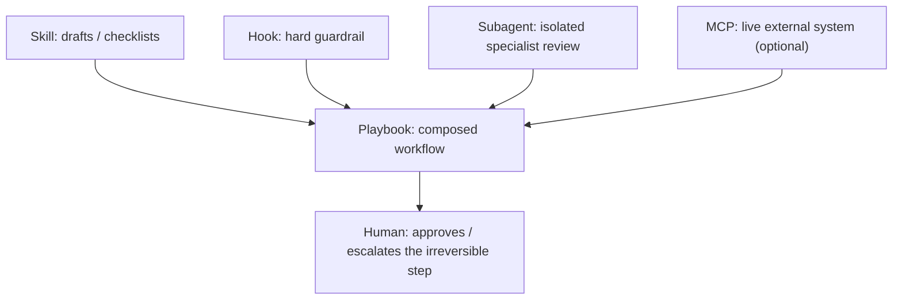

# 11 — Ops playbooks: composing skills, hooks, subagents, and MCP

## At a glance

| | |
| --- | --- |
| **Level** | Advanced (capstone) |
| **Time** | ~2 h |
| **Prereq** | All prior modules — this is where they compose |
| **Artifacts** | Three playbooks in this folder; your capstone pack goes under [`../artifacts/`](../artifacts/), teach-back note in [`../artifacts/demos/`](../artifacts/demos/) |

## Why this matters

Every individual module in this curriculum teaches one lever — a skill, a hook, a subagent, an MCP connection, a permission mode. Real staff work never uses exactly one lever. A PR review workflow needs a skill to draft the summary, a hook to block secrets before they're even staged, and maybe a subagent to review the diff with fresh context. An incident needs a triage skill, a background task watching logs, and a clear escalation point where a human — not Claude — makes the call. This module is the **capstone**: you compose what you've learned into three ops playbooks a real team could run under pressure, then assemble your own pack and teach it back.

## Concept primer

A **playbook**, in this curriculum's sense, is a short, composed doc that names *which levers fire in what order* for one recurring workflow — not a new abstraction, just the connective tissue between skill/hook/subagent/MCP you already know individually.

| Playbook | Composes | Optional MCP |
| --- | --- | --- |
| [`pr-review-pipeline.md`](pr-review-pipeline.md) | Skill (draft summary) + hook (block secrets/protected paths) + subagent (diff review) | GitHub MCP for live PR comments |
| [`incident-triage.md`](incident-triage.md) | Skill (triage checklist) + background task (log tailing) + human escalation gate | Monitoring/paging MCP |
| [`release-guardrails.md`](release-guardrails.md) | Hook (pre-release checks) + skill (changelog draft) + plan mode (see the release plan before it executes) | CI/deploy MCP |

> **Important:** every playbook here ends at a human decision point for anything irreversible (merge, page someone, deploy to prod). Composing tools doesn't mean composing away judgment.

## Hands-on walkthrough

1. **Read all three playbooks before touching anything.**
   - Action: read [`pr-review-pipeline.md`](pr-review-pipeline.md), [`incident-triage.md`](incident-triage.md), and [`release-guardrails.md`](release-guardrails.md) end to end.
   - Expect: for each, you can name the skill/hook/subagent/MCP it composes and the exact point a human must approve something.

2. **Pick one playbook and adapt it to a real workflow you own.**
   - Action: copy one playbook's structure and rewrite the specifics (which repo, which checks, which escalation contact) for something real at your job.
   - Expect: a version specific enough that a teammate could run it without asking you what "the secrets check" actually checks.

3. **Assemble your pack under `artifacts/`.**
   - Action: gather what this playbook needs — a skill under `../artifacts/skills/`, a hook under `../artifacts/hooks/`, an agent under `../artifacts/agents/` — even lightweight versions. If you sketched a plugin manifest in module 07, this is the pack it would bundle.
   - Expect: `../artifacts/` has real files that back your chosen playbook, not just a description of what they'd contain.

4. **Dry-run the playbook once.**
   - Action: walk through the playbook's steps against a real or realistic scenario (an actual small PR, a simulated incident, a staged release note) and note where it worked and where the doc was wrong about timing or ownership.
   - Expect: at least one correction to the playbook based on actually running it, not just reading it.

5. **Do the 10-minute teach-back.**
   - Action: fill in [`teach-back.template.md`](teach-back.template.md) as if you were explaining your composed pack to a teammate in 10 minutes — what it does, why each lever is there, where the human gate is. Save it as `../artifacts/demos/teach-back-capstone.md`.
   - Expect: someone who has never seen your pack could read the teach-back and know when to reach for it.

## Copy-paste templates

- [`pr-review-pipeline.md`](pr-review-pipeline.md)
- [`incident-triage.md`](incident-triage.md)
- [`release-guardrails.md`](release-guardrails.md)
- [`teach-back.template.md`](teach-back.template.md)

## How it works

- Composition order matters: **hooks fire first** (hard, mechanical, can't be argued with mid-task), **skills structure the work** (checklists, drafts, progressive disclosure), **subagents isolate context** (a diff reviewer shouldn't share context with the PR-description drafter), and **MCP is the optional live connection** to whatever external system the workflow ultimately reports to.
- The human gate is not a UX nicety — it's where you encode "this step is irreversible or costly enough that a person, not a classifier, decides." Auto mode's classifier (module 09) blocks obviously bad actions; it does not replace this gate for things that are *technically* safe but organizationally consequential (like "post publicly," "page the on-call person," "merge to main").
- A playbook you've actually run once and corrected is worth more than three you've only outlined — that's why the walkthrough requires a dry run before the teach-back.

## Pitfalls

1. **Writing a playbook nobody has run.** It reads fine, then falls apart on first real use because a step assumed context that wasn't there.
   - Fix: dry-run before you call it done — this module's step 4 isn't optional.
2. **No human gate on the irreversible step.** Composing skill + hook + subagent + MCP can make a workflow feel fully automated when it shouldn't be.
   - Fix: name the exact step a human approves, in the playbook itself, not just in your head.
3. **One giant playbook trying to cover every case.** Incident triage for a database outage and incident triage for a bad deploy don't need the same doc.
   - Fix: keep playbooks scoped to one recognizable trigger condition; branch to a different playbook rather than branching *inside* one.
4. **Treating the MCP integration as required.** All three playbooks here mark MCP optional for a reason — the workflow should degrade gracefully (manual PR comment, manual page) if the MCP server is down.
   - Fix: write the manual fallback step, don't just assume the integration is always up.
5. **Skipping the teach-back because "it's obvious."** If you can't explain it in 10 minutes, the pack probably has an undocumented assumption.
   - Fix: do the teach-back for real, even solo — narrate it out loud or write it as if presenting.

## Knowledge check

1. **Q:** What's the difference between a "playbook" as used here and a single skill?
   **A:** A playbook composes multiple levers (skill/hook/subagent/MCP) for one workflow and specifies ordering and the human gate; a skill is one reusable unit inside that composition.
2. **Q:** Why do hooks fire before skills in the composition order described here?
   **A:** Hooks are hard, mechanical guardrails that shouldn't be negotiable mid-task — they need to block bad actions before the more flexible skill-driven work proceeds.
3. **Q:** Give an example of a step that needs a human gate even though a classifier (Auto mode) would technically allow it.
   **A:** Any organizationally consequential but "safe" action — merging to main, paging someone, posting a public comment.
4. **Q:** Why does each playbook mark its MCP integration as optional?
   **A:** So the workflow degrades gracefully with a manual fallback if the external MCP server is unavailable, instead of being fully blocked.
5. **Q:** What's the required step before you can call a playbook "done" in this module?
   **A:** A dry run against a real or realistic scenario, with at least one correction noted from actually running it.

## Acceptance criteria

- [ ] At least one adapted playbook under `artifacts/playbooks/` (e.g. `MY-pr-review.md`)
- [ ] One dry run evidenced under `artifacts/demos/`
- [ ] Teach-back note completed (`artifacts/demos/teachback.md` or from `teach-back.template.md`)
- [ ] Human gate named explicitly in the playbook you chose

## Recap

You've read, adapted, and dry-run at least one composed ops playbook; assembled a real (if lightweight) pack of skill/hook/agent artifacts backing it; and produced a teach-back note that a teammate could use cold. This is the composition point for everything modules 01–10 taught individually.

## Stretch

Take the playbook you didn't adapt and sketch the plugin manifest (module 07) that would bundle it for team-wide install — then compare the manifest against your module 07 sketch. What's different now that you've actually run a playbook once?

## Feedback

If a teammate paged you at 2 a.m. and said "just run your incident playbook," could they actually do it from your doc alone — or would they need to text you first?

## Domain Stretch (optional)

Meridian mapping: a fourth playbook — `iiq-cert-cycle.md` — could compose the SoD skill, the `base/ga` guard hook, and the IIQ MCP tools for a certification campaign. Skip if you're not on the Meridian/IIQ track; the three playbooks above are the required capstone.
