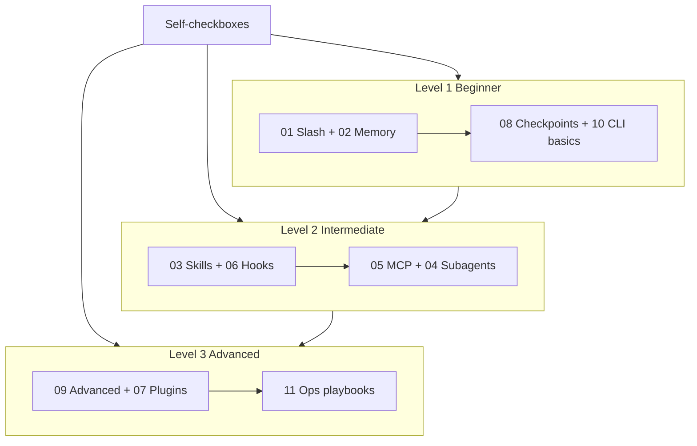

# Learning roadmap

Find your level with the checkboxes below (free). Prefer the [static site](../site/README.md) (`npm run dev`) for visuals and the progress board. In-Claude quizzes are **not** on the default path.

---

## Find your level

Check what you already do:

- [ ] I can start Claude Code and chat (`claude` / `cc`)
- [ ] I have created or edited a `CLAUDE.md`
- [ ] I have used at least 3 built-in slash commands (`/help`, `/compact`, `/model`, …)
- [ ] I have created a custom skill (`SKILL.md`) or slash command
- [ ] I have configured an MCP server
- [ ] I have set up hooks in settings
- [ ] I have created or used custom subagents
- [ ] I have used print mode (`claude -p`) for scripting or CI

| Checks | Level | Start at | Time left |
| --- | --- | --- | --- |
| 0–2 | **Beginner** | [01 Slash](01-slash-commands/) → [02 Memory](02-memory/) | ~3 h |
| 3–5 | **Intermediate** | [03 Skills](03-skills/) → [06 Hooks](06-hooks/) | ~5 h |
| 6–8 | **Advanced** | [09 Advanced](09-advanced/) → [11 Ops](11-ops-playbooks/) | ~5 h |

> **Tip:** If unsure, start one level lower.

---

## Learning philosophy

1. **Dependencies** — foundations first  
2. **Complexity** — easier before harder  
3. **Frequency** — high-leverage habits early  

---

## Recommended order (full path)

| Step | Module | Why now |
| --- | --- | --- |
| 1 | [01-slash-commands](01-slash-commands/) | Instant reusable shortcuts |
| 2 | [02-memory](02-memory/) | Stop re-teaching the repo every session |
| 3 | [08-checkpoints](08-checkpoints/) | Safe experimentation before deeper automation |
| 4 | [10-cli](10-cli/) | Headless and scripting literacy |
| 5 | [03-skills](03-skills/) | Auto-invoked workflows with progressive disclosure |
| 6 | [06-hooks](06-hooks/) | Hard guardrails (secrets, protected paths) |
| 7 | [05-mcp](05-mcp/) | Live tools without copy-paste |
| 8 | [04-subagents](04-subagents/) | Specialize context and tools |
| 9 | [09-advanced](09-advanced/) | Plan mode, permissions, background work |
| 10 | [07-plugins](07-plugins/) | Bundle for teams |
| 11 | [11-ops-playbooks](11-ops-playbooks/) | Compose everything into staff workflows |

---

## Cost model

| Action | Cost |
| --- | --- |
| Read static site / markdown | None |
| Copy templates / do labs in editor | None |
| Progress board in browser | None |
| Ask Claude to implement a lab for you | Uses tokens — optional |

---

## Done looks like

- [ ] Site progress board / `progress.md` reflects honest completion  
- [ ] `artifacts/` holds skills/hooks/agents you would reuse next week  
- [ ] You can explain *when* to use a skill vs hook vs subagent vs MCP to a teammate  
