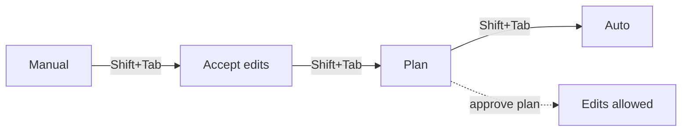

:::tip[Zero tokens]
This page is static. Read and do the labs in your editor/terminal — no Claude session required for learning.
:::

## At a glance

| | |
| --- | --- |
| **Level** | Advanced |
| **Time** | ~1–2 h |
| **Prereq** | [06-hooks](../06-hooks/) and [08-checkpoints](../08-checkpoints/) |
| **Artifacts** | Templates in this folder; your lab output goes in [`../artifacts/playbooks/`](../artifacts/playbooks/) |

## Why this matters

You're about to point Claude at a task that could touch 40 files, and you genuinely don't know the blast radius yet. Jumping straight to "make the change" means you're reviewing a diff after the fact, hoping you catch the one file it shouldn't have touched. A staff engineer's instinct here is the same one you'd apply to a junior's PR: **see the plan before you see the diff.**

This module is about the levers that make that safe and fast: plan mode (research before edit), permission modes (how much Claude does without asking), background tasks (long builds that shouldn't block your session), and extended thinking (when the model should slow down before acting).

## Concept primer

**Permission modes** — cycle with `Shift+Tab`:

| Mode | What Claude can do without asking | Reach for it when |
| --- | --- | --- |
| **Manual** (default) | Asks before file edits and shell commands | Default — new repo, high-stakes area |
| **Accept edits** | Edits files, runs common filesystem commands (`mkdir`, `mv`) without asking | You're iterating fast on non-critical code |
| **Plan** | Reads and runs read-only commands only — no source edits until you approve | Task scope is unclear; you want a plan first |
| **Auto** | Everything, screened by a background safety classifier that blocks irreversible/destructive/external actions | Long, multi-step tasks; reduces prompt fatigue without going fully unsafe |
| **dontAsk** | Only pre-approved tools run | Locked-down CI / scripted runs |
| **bypassPermissions** | Everything, no checks | Isolated containers/VMs **only** — never your laptop with prod creds |

**Plan mode**, specifically: Claude explores (reads files, runs read-only shell) and proposes a plan, but source edits stay blocked until you approve it. This is the two-phase pattern — *research, then implement* — that produces better results than jumping straight to code on anything non-trivial.

**Background tasks**: long-running processes (dev servers, watch builds, big test suites) can run with `run_in_background: true` instead of blocking the whole session. List/stop them with `/tasks`.

**Extended thinking**: toggled with `Tab` (or `Alt+T` / `Option+T`) — trades latency for a deeper reasoning pass before Claude acts. Worth it for architecture decisions and gnarly bugs; wasteful for "rename this variable."

## Hands-on walkthrough

1. **Enter plan mode on a real, unclear task.**
   - Action: pick something in this repo you genuinely don't know the scope of yet (e.g., "how would I add rate limiting to the API layer?"). Press `Shift+Tab` until you're in Plan mode, then ask.
   - Expect: Claude reads/explores but proposes a plan instead of editing files. You can see exactly which files it *intends* to touch before anything changes.
   - > **Tip:** if a proposed plan lists a file you didn't expect, that's the whole point of doing this in plan mode instead of after the diff.

2. **Approve (or reject) the plan deliberately.**
   - Action: read the plan, ask one clarifying/pushback question if something looks off, then approve.
   - Expect: only after approval does Claude start editing — you made the "should this happen" decision before any file changed.

3. **Compare permission modes side by side.**
   - Action: do a small, low-stakes edit in Manual mode (approve each step), then do a similarly-sized edit in Accept-edits mode.
   - Expect: you can articulate, in one sentence each, when you'd choose Manual vs Accept edits vs Auto for a *real* task at work — not just "Auto is faster."

4. **Kick off a background task.**
   - Action: ask Claude to start something long-running (a test suite, a watch build, a dev server) and continue working on something else while it runs. Check on it with `/tasks`.
   - Expect: your session isn't blocked; `/tasks` shows the running job; you can stop it if it hangs.

5. **Toggle extended thinking on a real decision.**
   - Action: ask an architecture-shaped question ("should this be a hook or a subagent?") once with extended thinking off, once with it on (`Tab` to toggle). Compare the reasoning depth, not just the answer.
   - Expect: you can tell a teammate a concrete situation where you'd flip this on versus leave it off by default.

6. **Write your plan-first runbook note.**
   - Action: fill in [`plan-first-runbook.template.md`](/templates/09-advanced/plan-first-runbook.template.md) for one real recurring task at your job (a migration, a refactor, an incident type) and save it as `../artifacts/playbooks/plan-first-runbook.md`.
   - Expect: a teammate could follow it to run the same task safely without you in the room.

## Copy-paste templates

- [`config-examples.json`](/templates/09-advanced/config-examples.json) — permission-mode settings examples (no secrets — adapt before use).
- [`plan-first-runbook.template.md`](/templates/09-advanced/plan-first-runbook.template.md) — plan-mode-first runbook skeleton.

## How it works

- Permission mode is a *session* setting you cycle with `Shift+Tab`, but you can also set a project or org default via `defaultMode` in `.claude/settings.json` — see `config-examples.json`.
- **Auto mode** doesn't mean "no checks" — it routes every tool call through a classifier that blocks anything irreversible, destructive, or reaching outside your trusted environment (repo + configured remotes by default). Deny rules and explicit `ask` rules in settings are still evaluated *before* the classifier and still win.
- In **Plan mode**, if auto mode is available and `useAutoModeDuringPlan` is on (default), the classifier — not you — approves read-only-adjacent shell commands during planning. Otherwise every non-read-only command prompts you individually while you're still just exploring.
- Background tasks keep running after a `-p`/print-mode run's final result returns; they don't just die when the foreground response finishes.

## Pitfalls

1. **Using `bypassPermissions` outside an isolated sandbox.** This mode skips essentially all checks — fine in a throwaway container, dangerous on a machine with real credentials.
   - Fix: reserve it for containers/VMs; keep `permissions.disableBypassPermissionsMode` set org-wide if you want to prevent it entirely.
2. **Treating Auto mode as "fully unsupervised."** The classifier blocks obviously bad actions, not everything you'd personally object to.
   - Fix: still skim the diff/summary after an Auto-mode run, especially the first few times you use it on a given repo.
3. **Skipping plan mode on "should be simple" tasks that aren't.** The tasks that most need a plan are the ones that *look* simple until you're three files deep.
   - Fix: default to plan mode whenever you can't already name every file the change will touch.
4. **Extended thinking on everything, burning latency/tokens on trivial asks.**
   - Fix: reserve it for decisions with real trade-offs (architecture, gnarly bugs) — leave it off for mechanical edits.
5. **Losing track of a background task and finding it still running (or stuck) an hour later.**
   - Fix: check `/tasks` before ending a session; stop anything you don't need still consuming resources.

## Knowledge check

1. **Q:** Which permission mode blocks source-file edits until you explicitly approve a plan?
   **A:** Plan mode.
2. **Q:** In Auto mode, what still runs *before* the safety classifier gets a say?
   **A:** Deny rules and explicit `ask` rules from settings — they're evaluated first and still block or prompt.
3. **Q:** When is `bypassPermissions` an acceptable choice?
   **A:** Only in an isolated container/VM — never on a machine with real/prod credentials.
4. **Q:** How do you keep a session working while a long test suite runs?
   **A:** Start it with `run_in_background: true` (or ask Claude to background it) and monitor/stop it with `/tasks`.
5. **Q:** Give one real situation where you'd toggle extended thinking on rather than leave it off.
   **A:** Any answer describing a non-trivial trade-off decision (architecture choice, ambiguous bug, hook-vs-subagent call) is correct.
6. **Q:** Why might a plan-mode shell command still prompt you for approval instead of just running?
   **A:** It's not in the built-in read-only set, and either auto mode isn't available or `useAutoModeDuringPlan` is off — so it falls back to asking.

## Acceptance criteria

- [ ] `artifacts/playbooks/plan-first-runbook.md` completed
- [ ] One plan-first dry run performed
- [ ] Bypass-style modes are not your default

## Recap

You can now choose a permission mode deliberately instead of defaulting to whatever the last session left you in, use plan mode to see intended file changes before they happen, background long-running work instead of blocking your session, and you have a plan-first runbook for one real recurring task.

## Stretch

Take your plan-first runbook and try it on the actual task it describes (or a close simulation) end to end — plan, approve, background any long step, and note where the runbook was wrong about scope.

## Feedback

What's one task at your job where you've been skipping plan mode purely out of habit, even though you couldn't confidently list every file it would touch?

## Domain Stretch (optional)

Meridian mapping: plan mode before any durable XML change under `config/` — see the intended `%%TOKENS%%` diff before `./build.sh` actually mutates anything. Skip if you're not on the Meridian/IIQ track.

