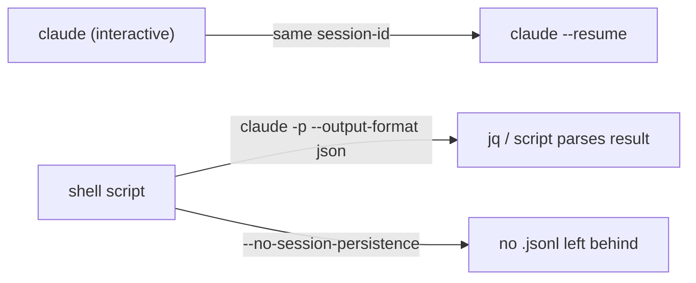

:::tip[Zero tokens]
This page is static. Read and do the labs in your editor/terminal — no Claude session required for learning.
:::

## At a glance

| | |
| --- | --- |
| **Level** | Beginner+ (basics) / Advanced (headless + CI section) |
| **Time** | ~45 min |
| **Prereq** | None for basics; [06-hooks](../06-hooks/) helps for the CI section |
| **Artifacts** | Template in this folder; your lab output goes in [`../artifacts/demos/`](../artifacts/demos/) |

## Why this matters

Interactive Claude Code is great when you're sitting at the keyboard. It's the wrong tool the moment you want "summarize this log file in a CI step" or "generate a changelog entry as part of a release script" — you don't want a TUI, you want a function call with a return value. That's **print mode**: `claude -p` (or `--print`) turns Claude Code into a single-shot, scriptable command that reads a prompt in and gives structured output back, which is what lets you wire it into pipelines, git hooks, and cron jobs instead of only ever using it by hand.

## Concept primer

| Mode | Invocation | Output | Use for |
| --- | --- | --- | --- |
| **Interactive** | `claude` | TUI, streaming, tool-call visibility | Normal pair-programming sessions |
| **Print (headless)** | `claude -p "prompt"` or `claude --print "prompt"` | Plain text by default | One-shot scripted asks |
| **Print + JSON** | `claude -p --output-format json "prompt"` | Structured JSON (`result`, `session_id`, `usage`, `total_cost_usd`, `duration_ms`, …) | Anything a script needs to parse programmatically |
| **Print + stream-json** | `claude -p --output-format stream-json --verbose "prompt"` | Streaming JSON events | Long-running headless tasks where you want progress, not just a final blob |

**Piping in and out:**

```bash
# Pipe file content in as context
cat error.log | claude -p "what's the root cause of this failure?"

# Pipe Claude's output into another tool
claude -p --output-format json "list TODOs in src/" | jq -r '.result'
```

**Resume:** `claude --resume <session-id>` (or `-r`) picks a session back up with full prior context — including one you started interactively. Sessions live as append-only `.jsonl` logs; add `--no-session-persistence` in print mode if a one-off script run shouldn't leave a resumable trace at all.



## Hands-on walkthrough

1. **Run one headless prompt against a real small file.**
   - Action: pick a small file in this repo (a README, a config file) and run:
     ```bash
     claude -p "summarize what this file configures in 3 bullets" < path/to/small-file
     ```
   - Expect: plain-text output, no TUI, command exits back to your shell prompt.
   - Tip: this is the "does headless mode even work here" smoke test before you script anything more elaborate.

2. **Get the same answer as parseable JSON.**
   - Action: rerun with `--output-format json`, and pull just the answer text with `jq`:
     ```bash
     claude -p --output-format json "summarize what this file configures in 3 bullets" < path/to/small-file | jq -r '.result'
     ```
   - Expect: valid JSON on stdout; `jq` extracts the same summary text plus you can see `session_id`, `total_cost_usd`, and `duration_ms` in the full object.
   - > **Watch out:** don't assume the field names — they've shifted between CLI versions. Print the raw JSON once (`| jq .`) before writing a script that depends on a specific field.

3. **Resume that exact session.**
   - Action: copy the `session_id` from step 2's JSON, then run:
     ```bash
     claude --resume <session-id> -p "now summarize it in one sentence instead"
     ```
   - Expect: the follow-up answer is clearly informed by the first prompt's context, without you re-pasting the file.

4. **Try a one-off that leaves no trace.**
   - Action: run a throwaway headless prompt with `--no-session-persistence`.
   - Expect: it answers normally, but there's no session to `--resume` afterward — useful for scripted runs you don't want cluttering `~/.claude/projects/`.

5. **Save your headless output as the lab artifact.**
   - Action: take the exact command + JSON output from step 2 and fill them into [`headless-prompt.template.md`](/templates/10-cli/headless-prompt.template.md), saved as `../artifacts/demos/headless-prompt-output.md`.
   - Expect: a teammate could copy your command verbatim and get a comparable result on their own machine.

## Copy-paste templates

- [`headless-prompt.template.md`](/templates/10-cli/headless-prompt.template.md) — command + expected-output skeleton for a scripted prompt.

## How it works

- `-p`/`--print` bypasses the interactive TUI entirely — Claude runs the prompt, executes any tool calls it needs (subject to permission mode, same as interactive), and exits after returning a result. There's no follow-up turn unless you `--resume`.
- JSON output includes token usage and `total_cost_usd` per call — this is what you'd log/alert on if you're running headless Claude in a pipeline you care about cost for.
- `stream-json` matters once a headless task runs long enough that "silence until the final result" isn't acceptable — CI logs, progress bars, or a supervising script that wants to react mid-run.
- Session files are keyed by working directory (`~/.claude/projects/<encoded-cwd>/<session-id>.jsonl`), so `--resume` without an ID picks the most recent session *for that directory* — running from a different folder won't find it by default.

## Pitfalls

1. **Parsing plain-text output in a script.** Text output is for humans; format/wording can shift.
   - Fix: always use `--output-format json` (or `stream-json`) when a script needs to parse the result.
2. **Assuming print mode has the same permission defaults as interactive.** A headless run in `dontAsk` mode with the wrong `allow` list either fails on missing approvals or, worse, over-approves.
   - Fix: pin `defaultMode` and `permissions.allow` explicitly in the settings the CI job uses — don't inherit whatever your laptop happens to have.
3. **Leaving persistent sessions from every CI run.** Each `-p` run without `--no-session-persistence` writes a `.jsonl` file — fine occasionally, noisy at scale.
   - Fix: use `--no-session-persistence` for one-off scripted runs that don't need `--resume` later.
4. **Piping secrets into a prompt via `cat`.** `cat .env | claude -p "..."` sends your secrets straight into the conversation/log.
   - Fix: never pipe credential files in; redact or exclude before piping anything into a headless run.
5. **Forgetting `--resume` needs the same working directory (pre-v2.1.223 behavior) or a cross-directory session ID lookup.** A script that `cd`s elsewhere before resuming can silently fail to find the session.
   - Fix: resume from the same directory the original session ran in, or pass the explicit session ID and confirm your CLI version supports cross-directory lookup.

## Knowledge check

1. **Q:** What flag turns Claude Code into a scriptable, non-interactive command?
   **A:** `-p` / `--print`.
2. **Q:** Why should a script always request `--output-format json` instead of parsing plain text?
   **A:** Plain text is for humans and can change wording; JSON gives stable, parseable fields (`result`, `session_id`, `usage`, `total_cost_usd`, etc.).
3. **Q:** How do you continue a previous session — including one started interactively — from the CLI?
   **A:** `claude --resume <session-id>` (or `-r`).
4. **Q:** When would you add `--no-session-persistence`?
   **A:** For one-off/scripted headless runs that don't need to be resumed later and shouldn't leave a `.jsonl` trace.
5. **Q:** What's wrong with `cat .env | claude -p "explain this config"`?
   **A:** It pipes secrets directly into the prompt/conversation — never pipe credential files into Claude.
6. **Q:** What does `--output-format stream-json` give you that plain `json` doesn't?
   **A:** Streaming events during a long headless run instead of only a final blob — useful for progress/logging in CI.

## Acceptance criteria

- [ ] Headless `-p` run completed; JSON output saved under `artifacts/demos/` (e.g. from `headless-prompt.template.md`)
- [ ] You resumed or documented how `--resume` works for your CLI version
- [ ] Three CI hygiene rules noted (no secrets in prompts; pin permissions; prefer structured output)

## Recap

You've run a real headless prompt, parsed its JSON output with `jq`, resumed the session with follow-up context, and tried a no-trace one-off — plus you have a saved example in `../artifacts/demos/` a teammate could reuse.

## Stretch

Wire a headless prompt into an actual script — a git pre-push hook, a Makefile target, or a small CI step — that pipes in a diff or log file and fails the step (non-zero exit) based on something in the JSON result.

## Feedback

What's one manual, repetitive prompt you type into interactive Claude Code that could become a one-line `claude -p` call in a script instead?

## Domain Stretch (optional)

Meridian mapping: a headless `claude -p` call summarizing the last `./build.sh` log, or explaining a `%%TOKENS%%` diff, is a natural fit for a pre-PR script in this repo. Skip if you're not on the Meridian/IIQ track.

